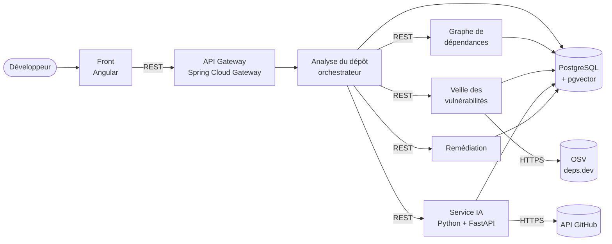

# [Nom du projet à définir]

Plateforme qui analyse les dépendances d'un projet Java ou JavaScript et indique **quelles vulnérabilités corriger en premier**.

## 1. Vision produit

**Problème.** Une application dépend de dizaines de bibliothèques tierces. Un scanner classique liste des CVE sans priorité, et ne montre ni les dépendances transitives vulnérables ni les bibliothèques abandonnées.

**Solution.** Le développeur téléverse un `pom.xml`, un `package-lock.json` ou un SBOM CycloneDX. La plateforme :

1. extrait les dépendances directes et transitives ;
2. détecte les vulnérabilités connues (OSV) ;
3. prédit le **risque de maintenance** de chaque bibliothèque (classifieur ML : faible, moyen, élevé) ;
4. calcule un **score de risque de 0 à 100** par vulnérabilité ;
5. produit un rapport avec l'**ordre de correction** et la version à viser.

**Utilisateurs.** Développeurs Java / JavaScript, responsables techniques et DevSecOps.

**Périmètre du MVP.** Entrées Maven, npm et CycloneDX ; un seul flux d'analyse, de bout en bout. Pas de plateforme SCA complète.

## 2. Architecture initiale



| Bloc | Technologie | Rôle |
|---|---|---|
| Front | Angular | Téléversement, tableau de bord, rapport, graphe de dépendances |
| Back principal | Spring Boot (Java) | Passerelle, analyse du dépôt (orchestration), graphe, intégration OSV, remédiation |
| Service IA | Python, FastAPI | Classifieur de risque de maintenance, score contextuel, explications NLP |
| Base de données | PostgreSQL 16 + pgvector | Projets, scans, dépendances, rapports et embeddings des avis |
| Déploiement | Docker Compose (développement), Kubernetes avec Minikube (cible) | |

Les services communiquent par appels REST synchrones, orchestrés par le service d'analyse du dépôt. Le scan s'exécute en tâche d'arrière-plan et le front interroge son état.

**Rôle de la base vectorielle.** Les descriptions des avis sont transformées en embeddings, stockés dans pgvector. Elles servent à retrouver des avis proches pour ancrer les explications en langage clair, et à la recherche sémantique. C'est un support de la partie NLP ; le composant ML principal est le classifieur de risque de maintenance. Choix argumenté : [`docs/choix_base_vectorielle.md`](docs/choix_base_vectorielle.md).

## 3. Matrice des responsabilités

**R** = responsable, **C** = contribue.

| Domaine | Lead Front | Lead Back | Lead IA | Lead DevOps |
|---|:-:|:-:|:-:|:-:|
| Interface Angular, tableau de bord | R | C | | |
| Services Spring Boot, passerelle | C | R | | |
| Intégration OSV, deps.dev, extraction des dépendances | | R | C | |
| Jeu de données et classifieur de risque de maintenance | | | R | |
| Service FastAPI, embeddings, base vectorielle | | C | R | C |
| Docker, intégration continue, Kubernetes (Minikube) | | C | | R |
| Tests d'intégration | C | C | C | R |
| Rapport et présentation | C | C | C | C |

| Rôle | Responsable |
|---|---|
| Lead Front | *[Nom]* |
| Lead Back | *[Nom]* |
| Lead IA | *[Nom]* |
| Lead DevOps | *[Nom]* |

## 4. Démarrage rapide (base vectorielle locale)

Prérequis : Docker et Docker Compose.

```bash
cp .env.example .env
docker compose up -d          # PostgreSQL 16 + pgvector, schéma créé automatiquement
./scripts/smoke_test.sh       # vérifie l'extension, la distance cosinus et la table
```

Arrêt : `docker compose down` (ajouter `-v` pour supprimer aussi les données).

## 5. Structure du dépôt

```
data/raw/
  advisories/{maven,npm}/   307 avis de sécurité au format OSV
  samples/                  pom.xml, package.json, package-lock.json, sbom.cdx.json
  README.md                 sources, sélection, limites
db/init/001_init.sql        extension pgvector, table advisories, index
docs/choix_base_vectorielle.md
scripts/fetch_advisories.py reconstruit le corpus
scripts/smoke_test.sh       test de la base locale
docker-compose.yml
```
